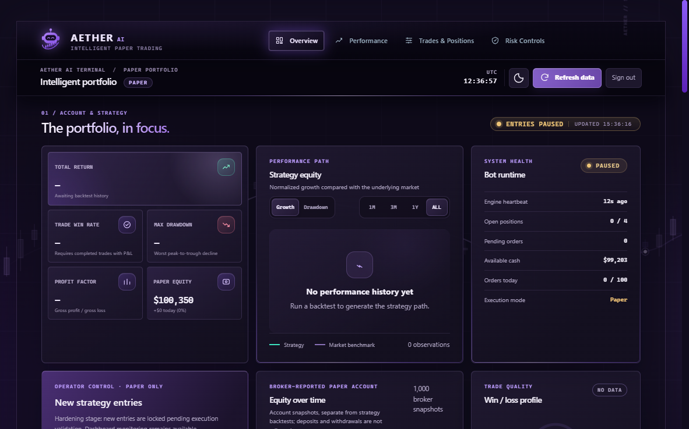
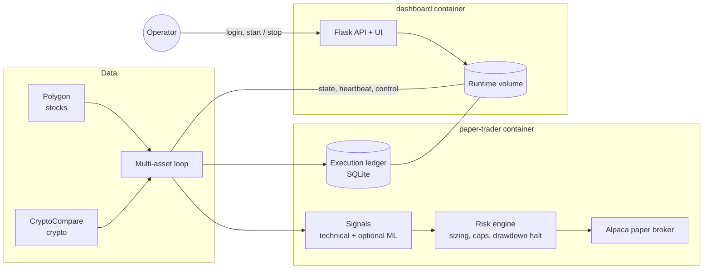

<div align="center">


# Aether AI

**A risk-first paper-trading research bot for US stocks and crypto, with an authenticated real-time control center.**

[](https://github.com/ArgirisViv/micro-trading-bot/actions/workflows/ci.yml)




</div>

> **Paper trading only.** This is an engineering and research project. It refuses non-paper broker endpoints, has no verified profitability record and is not financial advice. See [Status and limits](#status-and-limits).

## Highlights

- **Safety-first execution.** Alpaca paper-endpoint guard, long-only entries, cash-capped sizing from the actual fixed-stop policy, daily drawdown halt, order cap and position cap.
- **Durable execution ledger.** SQLite-backed order records and broker reconciliation. Uncertain submissions lock further entries instead of guessing.
- **Signals.** Technical indicators with an optional, locally trained ML overlay. Signals keep working when no model artifact is present.
- **Market awareness.** Alpaca market-clock gating for stocks and a session-aware backtester with an explicit broker calendar, configurable fee/slippage assumptions and conservative stop-first handling.
- **Operator control center.** Authenticated Flask dashboard with account registration, server-side sessions, CSRF protection, an animated trading-themed background and a **Start / Stop bot** control. Missing or corrupt control state fails closed to *paused*.
- **Honest analytics.** Backtest metrics, walk-forward summaries and broker-reported paper equity are labeled by source. Order submission is never presented as a fill.
- **Reproducible deployment.** Two-service Docker Compose stack with healthchecks, a non-root image and a persistent runtime volume.

## Dashboard

| Area | What it shows |
| --- | --- |
| Overview | Total return, win rate, max drawdown, profit factor and paper equity with status pills |
| Performance | Strategy equity vs. market benchmark, walk-forward windows, monthly returns |
| Trades & Positions | Open positions, submitted orders and the execution ledger |
| Risk Controls | Trading universe, risk limits, execution policy and entry control |

The interface is responsive down to 320 px, respects `prefers-reduced-motion` and uses a dark violet theme with subtle interactive effects.

## Architecture



| Path | Purpose |
| --- | --- |
| `data/` | Polygon and CryptoCompare feed adapters |
| `core/` | Strategy, indicators, risk, execution ledger and broker boundary |
| `scripts/paper_trading/` | Multi-asset loop and crypto exit supervisor |
| `scripts/backtesting/` | Offline and walk-forward research tooling |
| `webapp/` | Flask API and the browser interface |
| `tests_safe/` | Isolated offline tests, no real broker orders |
| `docs/` | Stage-by-stage hardening notes ([index](docs/CHECKPOINTS.md)) |

## Quick start

Requires Python 3.11+.

```bash
git clone https://github.com/ArgirisViv/micro-trading-bot.git
cd micro-trading-bot
python -m venv .venv
source .venv/bin/activate            # Windows: .\.venv\Scripts\Activate.ps1
python -m pip install -r requirements.txt "pytest>=7.4,<9"
python -m pytest -q                  # offline suite

cp .env.example .env.local           # Windows: Copy-Item .env.example .env.local
python -m scripts.prepare_dashboard_auth
python -m webapp.server
```

Put the generated `DASHBOARD_*` values in `.env.local`, open <http://127.0.0.1:8080> and **create an account** from the login screen. New entries start *paused*; nothing can be placed until you explicitly start the bot and the paper trader is configured.

### Run the trader (paper only)

```bash
python -m scripts.paper_trading.multi_asset_loop
```

Use a dedicated Alpaca **paper** account.

## Docker

```bash
python -m scripts.check_docker_config
docker compose up --build --detach
docker compose ps
```

On Windows, `Start-Aether.ps1` runs those steps.

- `dashboard` serves the UI on `127.0.0.1:8080` through gunicorn (one worker, so the in-memory login limiter is not split).
- `paper-trader` runs the strategy loop; its healthcheck measures the loop heartbeat.
- Both share a named volume for state, the execution ledger, the control file and dashboard accounts.
- Both use `restart: unless-stopped`.
- Do not expose the dashboard directly to the internet; use an authenticated SSH tunnel or another protected access layer.

## Configuration

All settings live in `.env.local` (copy of [.env.example](.env.example)):

| Group | Variables |
| --- | --- |
| Broker | `APCA_API_KEY_ID`, `APCA_API_SECRET_KEY` |
| Market data | `POLYGON_API_KEY`, `CRYPTOCOMPARE_API_KEY` |
| Universe | `STOCK_WATCHLIST`, `CRYPTO_WATCHLIST`, `TIMEFRAME` |
| Risk | `RISK_PER_TRADE`, `STOP_LOSS_PCT`, `TAKE_PROFIT_PCT`, `MAX_PORTFOLIO_POSITIONS`, `MAX_DAILY_ORDERS`, `MAX_DAILY_DRAWDOWN_PCT` |
| Dashboard | `DASHBOARD_PORT`, `DASHBOARD_SESSION_SECRET`, `DASHBOARD_PASSWORD_HASH`, `DASHBOARD_COOKIE_SECURE`, `DASHBOARD_ACCOUNTS_DB` |

## Security

- `.env.local`, logs, SQLite databases, trading state and model artifacts are git-ignored. **Never commit credentials.**
- Dashboard access requires a login, with server-side sessions, CSRF protection and rate-limited sign-in.
- The API can only start/stop/pause/resume the bot; no endpoint places an order.
- Broker URLs must be Alpaca paper endpoints. Live and lookalike hosts are rejected.
- Never load a model file from an untrusted source: joblib/pickle artifacts can execute code.

## Testing

```bash
python -m pytest -q
```

The suite covers broker guardrails, the execution ledger and reconciliation, session-aware backtests, signal fallback, operator control and the dashboard API. All tests are offline.

## Status and limits

This is a **portfolio-quality paper-trading prototype**, not a live-money system.

- Tests are offline. They do not establish a profitable strategy or validate broker integration.
- Backtests are illustrative. Simulated fees and slippage are assumptions, not measured costs, and the simulator does not model queueing, partial fills or DAY-bracket expiry.
- Crypto has no broker-side bracket protection; its software exits only run while the loop and data feeds are healthy.
- Stopping the bot prevents new entries at the next control check but cannot guarantee that an in-flight submission is canceled.
- The loop still needs broker fill reconciliation and restart recovery before any unattended use.

More detail: [hardening checkpoints](docs/CHECKPOINTS.md), [technical review](REVIEW_REPORT.md), [portfolio notes](docs/PORTFOLIO.md).

## License

Released under the [MIT License](LICENSE).
